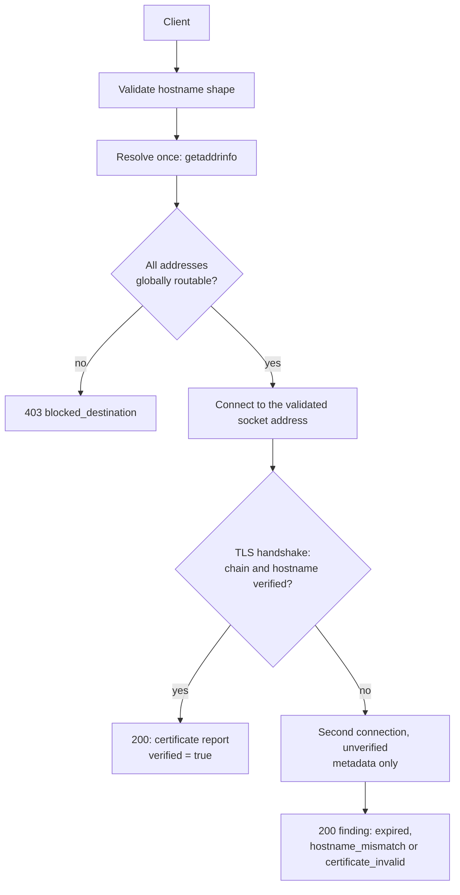
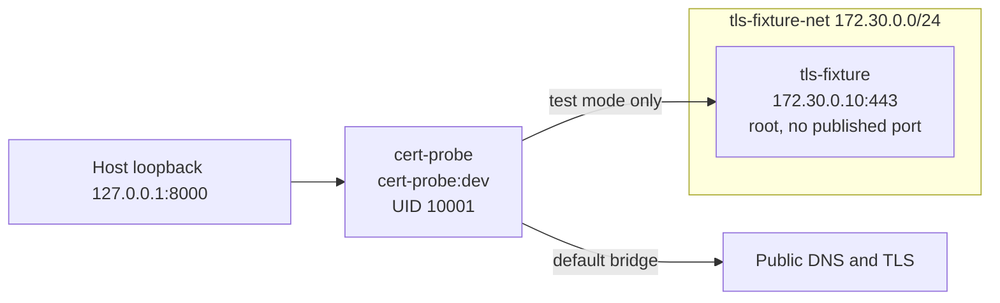

# Cert Probe

A small, security-conscious HTTP API that inspects the TLS certificate of a hostname and reports whether it would verify.

`v0.1.0` · Python 3.12 · Phase 9 complete

> Formerly named TLS Checker. Records in `docs/` retain the original image tags, container names and CA common name because they are transcripts of runs performed under that name.

--------

## What it does

`POST /check` takes one DNS hostname and answers a single question: if a client connected to this hostname over TLS right now, would the certificate verify?

The service resolves the hostname once, refuses to connect to anything that is not globally routable, connects to the address it already validated, performs a TLS handshake with full chain and hostname verification, and returns the certificate details. 

No HTTP request is ever sent to the target — the handshake is the entire interaction.
<br>



```bash
curl -s -X POST http://127.0.0.1:8000/check \
  -H 'Content-Type: application/json' \
  -d '{"hostname":"example.com"}'
```

```json
{
  "hostname": "example.com",
  "verified": true,
  "hostname_verified": true,
  "subject": "CN=example.com",
  "issuer": "C=US, O=DigiCert Inc, CN=DigiCert Global G2 TLS RSA SHA256 2020 CA1",
  "not_before": "2025-11-01T00:00:00Z",
  "not_after": "2026-11-01T23:59:59Z",
  "days_remaining": 358,
  "error": null
}
```

Values above are illustrative. 

`days_remaining` is derived from the certificate's expiry and can be negative for an expired certificate.

--------

## Quick start

#### Requirements: 
Docker Engine with the Compose plugin. 
`uv` is only needed for local Python work and for generating test certificates.
<br>

From the project directory:

```bash
docker compose up -d --build
curl -s http://127.0.0.1:8000/health
curl -s -X POST http://127.0.0.1:8000/check \
  -H 'Content-Type: application/json' \
  -d '{"hostname":"example.com"}'
docker compose down
```
<br>

`/health` returns `{"status":"ok"}`. 

*Note: The container is published on host loopback only, at `127.0.0.1:8000`.*

The Makefile wraps the same operations: `make build` then `make up` (which waits for the healthcheck), and `make verify` to run lint, types, tests, build, start, smoke checks and teardown in one gate.
`make up` uses `--no-build`, so build first.

-----

## HTTP API

### `GET /health`

Returns `{"status":"ok"}`. 
This is a liveness answer only: it does not resolve DNS, open a connection or touch TLS.
<br>

### `POST /check`

Request body:

| Field | Type | Notes |
|---|---|---|
| `hostname` | string | Required, single field, unknown fields rejected |

The hostname is normalised (lower-cased, one trailing dot removed) before the 253-character limit is applied. 

URLs, ports, userinfo, brackets, whitespace, non-ASCII and IP literals are rejected, as are labels longer than 63 characters and misplaced hyphens. 

Validation failures return `422` with the error envelope described below.
<br>

### Response semantics

A certificate finding is a successful answer, so it returns `200`. 
Only protocol and infrastructure failures use non-2xx statuses.
<br>

| Condition | HTTP | `verified` | `hostname_verified` | `error.kind` |
|---|---|---|---|---|
| Chain and hostname both verified | 200 | `true` | `true` | `null` |
| Expired certificate | 200 | `false` | `null` | `expired` |
| SAN does not match hostname | 200 | `false` | `false` | `hostname_mismatch` |
| Untrusted chain, e.g. self-signed | 200 | `false` | `null` | `certificate_invalid` |
| Destination blocked by policy | 403 | `null` | `null` | `blocked_destination` |
| DNS failure | 502 | `null` | `null` | `dns_failure` |
| DNS timeout | 504 | `null` | `null` | `dns_timeout` |
| DNS capacity exhausted | 503 | `null` | `null` | `dns_capacity_exceeded` |
| Connection failure | 502 | `null` | `null` | `connection_failure` |
| Connection timeout | 504 | `null` | `null` | `connection_timeout` |
| TLS handshake timeout | 504 | `null` | `null` | `tls_timeout` |
| Unexpected failure | 500 | `null` | `null` | `unknown_error` |
<br>

`hostname_verified` is `false` only for `hostname_mismatch`. 
The other certificate failures stop at chain verification, before a hostname check runs, so they report `null` rather than `false`. 

In the rare case where a handshake succeeds but the certificate cannot be parsed, the response is `500 unknown_error` with `verified: true`.
<br>

### Protocol errors

Validation, routing and unhandled errors use a separate envelope, because they are not certificate findings:

```json
{
  "error": {
    "kind": "validation_error",
    "message": "request body is invalid",
    "details": [
      {
        "loc": ["body", "hostname"],
        "type": "value_error",
        "msg": "hostname must not contain a URL scheme"
      }
    ]
  }
}
```

`kind` is one of `validation_error` (422), `not_found` (404), `method_not_allowed` (405), `http_error` (other HTTP errors) or `internal_error` (500). 
Only validation errors carry `details`.

FastAPI's generated documentation is available at `/docs`, `/redoc` and `/openapi.json`. 
Like the API itself, these are unauthenticated.

---

## Configuration

All values come from environment variables and are validated once at startup. 

Invalid configuration aborts the process rather than falling back to a default.

| Variable | Default | Meaning |
|---|---|---|
| `TLS_CHECKER_DNS_TIMEOUT` | `3.0` | DNS resolution budget, seconds |
| `TLS_CHECKER_CONNECT_TIMEOUT` | `5.0` | TCP connect budget per address attempt, seconds |
| `TLS_CHECKER_TLS_HANDSHAKE_TIMEOUT` | `5.0` | TLS handshake budget, seconds |
| `TLS_CHECKER_OVERALL_DEADLINE` | `10.0` | Whole-request budget, seconds; must be at least the largest phase timeout and at most `30.0` |
| `TLS_CHECKER_LOG_LEVEL` | `INFO` | `DEBUG`, `INFO`, `WARNING`, `ERROR` or `CRITICAL` |

Each phase timeout is applied as `min(phase_timeout, time remaining)`, so the overall deadline always wins. An empty variable is treated as unset.

Test-only variables are documented in [Local TLS fixture](#local-tls-fixture). They are rejected unless test mode is explicitly enabled.

------

## Security design

### Destination policy

The service is a deliberate SSRF boundary. Before any byte is sent:

1. The hostname is resolved exactly once.

2. Every returned address is classified: loopback, link-local, multicast, unspecified, CGNAT (`100.64.0.0/10`), private, reserved, and finally anything that `ipaddress.is_global` rejects. IPv4-mapped IPv6 addresses are unwrapped first, so `::ffff:127.0.0.1` cannot slip through.

3. If any address fails, the whole request is rejected with `403 blocked_destination`.

4. The connection targets the validated socket address, not the hostname, and TLS SNI still uses the original hostname.

5. No second DNS lookup happens, so a hostname that changes answer between validation and connection cannot redirect the request.

DNS runs in one shared, bounded thread pool: 8 workers, 24 queued jobs, 32 operations in flight in total. 

Beyond that the request fails fast with `503 dns_capacity_exceeded` instead of growing the queue. This is designed behaviour, not an outage.
<br>

### TLS policy

The primary connection uses `ssl.create_default_context()`, so the system trust store, chain validation and hostname verification all apply, with TLS 1.2 as the minimum version. 

When verification fails, a second, explicitly unverified connection retrieves the certificate so that subject, issuer and validity can still be reported. 

That second connection proves nothing about the server's identity and could be steered by a man-in-the-middle; its output never influences `verified` or `hostname_verified`.
<br>

### Container hardening

| Control | Configuration | Observed at runtime |
|---|---|---|
| Runtime user | UID/GID 10001, `nologin` shell | `User = app` |
| Root filesystem | `read_only: true` | `ReadonlyRootfs = true` |
| Writable temporary space | tmpfs `/tmp`, 64 MB | `Tmpfs = /tmp:size=64m` |
| Linux capabilities | `cap_drop: [ALL]` | `CapDrop = [ALL]` |
| Privilege escalation | `no-new-privileges:true` | `SecurityOpt = [no-new-privileges:true]` |
| Memory limit | `mem_limit: 256m` | `268,435,456` bytes |
| CPU limit | `cpus: 1.0` | `NanoCpus = 1,000,000,000` |
| Process limit | `pids_limit: 128` | `128` |
| Init process | `init: true` | `Init = true` |
| Host port binding | `127.0.0.1:8000:8000` | loopback only |
| Restart policy | `unless-stopped` | inherited |
| Healthcheck | Compose-level, Python stdlib | 10 s interval, 3 s timeout |

The application code and virtual environment are root-owned inside the image and remain readable but not writable by the runtime user. 

Uvicorn binds `0.0.0.0` inside the container because the Docker port-publish path requires it; exposure is constrained by the Compose binding, not by the process.
<br>

### Current security boundary

The service binds host loopback only and authentication is **not implemented**. 

This is an interim deployment restriction, not a permanent architectural decision: before exposing the API to other machines or the internet, authentication and appropriate access controls must be added. 

**The current build is not intended for public exposure.**

-----

## Local TLS fixture

The destination policy blocks every private and loopback address, which is exactly what it should do. 

That makes a local TLS fixture unreachable by design, and public test services cannot be relied on: their certificate states are fixed, their availability is intermittent, and handshake-delay scenarios cannot be constructed at all.
<br>

The test environment solves this with an overlay, not a fork. 

It uses the same application source, the same Dockerfile and the same `cert-probe:dev` image; 

`compose.yaml` is untouched and `compose.test.yaml` adds the fixture and the test-only settings.


<br>

Generate certificates first: this is required on a fresh clone, because the certificate directory is git-ignored. 

Without it the app aborts at startup when it cannot load the configured CA file.

```bash
./tests/fixture/generate.sh

docker compose -f compose.yaml -f compose.test.yaml up -d --build
```
<br>

**The generator creates a test CA and four leaf certificates, and asserts its own invariants before writing anything:**

| Certificate | Expected result |
|---|---|
| `valid.pem` | `200`, `verified: true`, `hostname_verified: true` |
| `expired.pem` | `200`, `verified: false`, `hostname_verified: null`, `error.kind: expired` |
| `wrong-cn.pem` | `200`, `verified: false`, `hostname_verified: false`, `error.kind: hostname_mismatch` |
| `self-signed.pem` | `200`, `verified: false`, `hostname_verified: null`, `error.kind: certificate_invalid` |

`wrong-cn.pem` carries `CN=tls-fixture` with `SAN=wrong-name`, so it fails at the SAN check rather than relying on legacy common-name behaviour.
<br>

Swapping the certificate requires container recreation, not a restart:

```bash
FIXTURE_CERT_FILE=/certs/expired.pem \
  docker compose -f compose.yaml -f compose.test.yaml \
  up -d --force-recreate --no-deps tls-fixture
```
<br>

A pre-handshake delay simulates a slow peer, and exercises the handshake timeout rather than the overall deadline:

```bash
FIXTURE_HANDSHAKE_DELAY_MS=8000 \
  docker compose -f compose.yaml -f compose.test.yaml \
  up -d --force-recreate --no-deps tls-fixture
```
<br>

### How the exception works

Four test-only variables enable the scenario: `TLS_CHECKER_TEST_MODE=1`, `TLS_CHECKER_FIXTURE_HOSTNAME=tls-fixture`, `TLS_CHECKER_FIXTURE_IP=172.30.0.10` and `TLS_CHECKER_ADDITIONAL_CA_FILE`.

The exemption lives in `resolve_and_validate()`, not in the classifier. `classify_ip()` is unchanged. 

When test mode is on, the hostname matches exactly, and the configured IP parses as RFC 1918 IPv4, the resolved addresses must **all** equal that IP; any other address, including a public one, raises `blocked_destination`. The exception is therefore all-or-nothing for a single configured name, not a relaxation of policy. 

`localhost` still returns `403`, and public destinations still work normally.

The additional CA is loaded on top of the system trust store, so normal verification stays enabled; it does not replace it. Configuration is fail-closed: any test variable without test mode, test mode without both hostname and IP, an IP outside RFC 1918, or an unloadable CA file aborts startup.
<br>

### Fixture limitations

The fixture container is deliberately minimal and is **not** hardened like the application. 

It runs as root so it can bind port 443, has no CPU, memory or PID limits, and no capability drop. Its isolation comes from elsewhere: it publishes no host port, it joins only `tls-fixture-net`, and only the application container is attached to that network. 

The network is not marked `internal`, so outbound traffic from the fixture itself is not blocked. 

None of this affects the application image.

**The two deployment modes are mutually exclusive, because both bind `127.0.0.1:8000`. 
Stop one before starting the other:**

```bash
docker compose -f compose.yaml -f compose.test.yaml down
docker compose up -d --build
```

In independent testing the fixture sustained roughly 1,650–2,150 handshakes per second with zero failures, so it was not the bottleneck in the capacity tests below.

-----

## Testing

```bash
make check
```

This runs `ruff format --check`, `ruff check`, `mypy` and `pytest`. 

The suite is offline and deterministic; there are nine test files containing 152 test functions before parametrisation.

| Area | Covered |
|---|---|
| Hostname validation and normalisation | Length and label limits, URLs, ports, userinfo, brackets, IP literals |
| Destination policy | Every blocked category, IPv4-mapped unwrapping, mixed-address rejection |
| DNS capacity | Slot accounting, fail-fast rejection, worker concurrency, shutdown |
| Deadline arithmetic | Phase timeouts shrinking to the remaining budget |
| Certificate handling | DER parsing, error classification, unverified fallback isolation |
| API contract | Status mapping, response shape, error envelope, tri-state invariants |
| Configuration | Fail-closed fixture validation, CA probing, immutability, caching |
| Logging | Field order, levels, no private data, handler idempotency |
<br>

### What is not covered

- **No automated integration test starts the fixture container.** The four certificate scenarios are verified manually with `curl` against the overlay, as shown above. Automating them is a candidate for a later phase.

- `pytest -m live` performs real network checks against external hosts and is excluded by default, because those hosts are intermittent.

- There is no CI pipeline and no coverage threshold configured.

- No load or soak testing is part of the automated suite; the capacity work was a separate, manual evaluation.

------

## Operations and development

| Command | Purpose |
|---|---|
| `make check` | Lint, type-check, run the offline test suite |
| `make format` | Apply `ruff format` and `ruff check --fix` |
| `make build` / `make rebuild` | Build the image, cached or with `--no-cache` |
| `make up` / `make down` | Start (waiting for healthy) or stop the deployment |
| `make verify` | Full gate: check, build, up, smoke, down (`KEEP=1` leaves it running) |
| `make smoke` | Deterministic checks for health, SSRF blocking and validation |
| `make logs` / `make inspect` | Follow logs, or print the active hardening settings |
| `make nuke` | Destructive cleanup of containers and all `cert-probe:*` images |
<br>

### Build and architectures

- The Dockerfile is a three-stage build: a pinned uv image supplies the binaries, a builder resolves `uv.lock` with `--locked --no-dev`, and the runtime stage copies only the virtual environment and `app/`. 

- Build tools and uv are not present in the final image, and neither are tests, docs or the Makefile.

- Base images are pinned by manifest-list digest. 
The same file builds natively for `linux/arm64` on the development host and `linux/amd64` on an Intel host, with no `--platform` override. 
Image builds have been verified on both architectures; see `docs/arm64-verification.md` and `docs/amd64-verification.md` for the detailed records.

- To refresh a base image, inspect the new manifest list, update both `ARG` digests, rebuild on each architecture and re-run verification:

	```bash
	docker buildx imagetools inspect python:3.12-slim
	docker buildx imagetools inspect ghcr.io/astral-sh/uv:0.13.6
	```
<br>

### Tested versions

Recorded on the development and verification hosts. 

These are the versions the project was tested with, not minimum requirements.

| Component | Version |
|---|---|
| OS | Ubuntu 24.04 LTS on WSL2, `linux/arm64` |
| Python | 3.12 |
| Docker Engine | 29.6.1 |
| Docker Compose | v5.3.1 |
| Package management | `uv`, with `uv.lock` committed |
| AMD64 verification host | Docker Engine 29.9.2 |
<br>

### Health, shutdown and logs

- The healthcheck uses Python's standard library, because the image intentionally contains no `curl` or `wget`. 

- It polls `/health` every 10 seconds with a 3-second timeout and a 5-second start period; the service is normally healthy within about six seconds.

- Docker's default stop grace period is 10 seconds, and the application's per-request deadline is also 10 seconds. 

- In the worst case, a request that entered just before `SIGTERM` could need slightly longer than the grace period, although observed drains completed in 1–1.5 seconds. 

- If you change these, never set `stop_grace_period` below `overall_deadline`; `15s` gives useful headroom. See `docs/graceful-shutdown.md`.

- Each `/check` produces one structured log line:

	```
	ts=2026-11-02T11:24:13.064Z level=INFO logger=app.main msg=check hostname=example.com
	outcome=ok verified=True status=200 duration_ms=279 address_count=4
	dns_duration_ms=105 method=POST path=/check
	```

- The hostname is logged; error messages, resolved IP addresses, certificate subject and issuer, request bodies and client addresses are not. Set `TLS_CHECKER_LOG_LEVEL` to change verbosity.

----

## Capacity and performance

*Note: Measurements were taken on the ARM64 WSL2 development host, with the application container limited to one CPU and 256 MiB.* 

Full methodology and evidence are in [docs/load-testing.md](docs/load-testing.md).

- **Throughput plateaus at roughly 118–125 requests per second** between concurrency 5 and 100 against the local fixture. More concurrency adds latency, not throughput: p50 rose from 21 ms at c=5 to 818 ms at c=100.

- **The plateau is CPU saturation at the one-CPU limit.** Two workloads with different per-request costs produced two plateaus; 117 RPS for the TLS path and 750 RPS for the localhost fast-rejection path;  which is the shape a CPU-bound system produces. The handler runs on AnyIO's worker pool (40 tokens by default), so requests beyond that queue before reaching application code.

- **A 300-second run at c=5 completed with zero errors:** 31,575 requests at 105 RPS. The probe ran inside the application container, competing for the same CPU budget, which likely explains the shortfall against the sweep. Only two of thirty resource samples overlapped the load.

- **Recovery after overload was immediate in the observed requests.** A 2,500-request burst was followed by ten serial requests; the first returned in 10.4 ms against an 8.6 ms baseline. The burst discarded response bodies and status codes, so it does not establish that every attempted request succeeded.

- **DNS exhaustion shows the designed failure mode.** Under a sustained NXDOMAIN load, 78.6% of 15,053 requests returned `503 dns_capacity_exceeded` and 21.4% returned `502 dns_failure`. Both are designed responses, not crashes.

- **External targets hit a different constraint.** Against `example.com` at c=20 the service reached 85 RPS at 78–91% CPU, consistent with network round-trip time contributing, though the network was not isolated as the cause.

- **Memory peaked at about 97 MiB of the 256 MiB limit.** Idle usage drifted upward across the session from 46 to 56 to 63 MiB and did not return fully to its previous level. The cause is unresolved and this is not a demonstrated leak.

- **`create_default_context()` costs about 3.75 ms p50**, because a fresh SSL context parses the system CA bundle on every request. That is roughly 52% of a derived 7.2 ms TLS-path delta; the percentage combines one measured figure with one derived figure.

These are single-host, single-client measurements of one workload family. 

They describe where this deployment saturates and how it fails; they are not a scalability claim.

---

## Known limitations

**Measurement limits**

- Single Uvicorn worker, single client, one source address; multi-client fairness was never exercised.
- GIL contention was not independently measured, and the location of queuing was not isolated.
- About 1.65 ms of the TLS-path delta is unaccounted for; decomposing it would need profiling.
- The 300-second run had partial resource sampling, and no multi-hour soak was performed.
- External test hosts are intermittent; the local fixture exists partly to avoid depending on them.
<br>

**Functional limits**

- Authentication and authorisation are not implemented; the service is loopback-only.
- No rate limiting. It was evaluated and deliberately not added, because the measurements showed no stability problem; fairness under multiple clients remains untested.
- No metrics endpoint, tracing or request identifiers.
- The SSL context is rebuilt per request; safe caching would need a key that still allows fixture certificate swaps to take effect.
- Certificate metadata from the unverified fallback is informational only and can be influenced by a man-in-the-middle.
- An explicit application-level request-body size limit is not currently configured.
- No automated integration tests for the fixture scenarios, and no CI pipeline.
- The fixture container runs as root without resource limits, as described above.

-----

## Repository layout

| Path | Contents |
|---|---|
| `app/main.py` | FastAPI factory, lifespan, endpoints, status mapping, request logging |
| `app/schemas.py` | Request validation and response models |
| `app/checker.py` | Deadline handling, verified handshake, metadata fallback, DER parsing |
| `app/netguard.py` | Address classification, bounded DNS resolution |
| `app/config.py` | Environment parsing and fail-closed validation |
| `app/errors.py`, `app/logging.py` | Error envelope, structured logging |
| `tests/` | Offline unit and API tests |
| `tests/fixture/` | Fixture server, certificate generator, fixture image |
| `compose.yaml`, `compose.test.yaml` | Normal deployment, test overlay |
| `Dockerfile`, `Makefile`, `pyproject.toml`, `uv.lock` | Build, workflow, dependencies |
| `docs/` | Verification and measurement records |

----

## Documentation

| Document | Contents |
|---|---|
| [docs/load-testing.md](docs/load-testing.md) | Full capacity methodology, measurements, findings and evidence index |
| [docs/arm64-verification.md](docs/arm64-verification.md) | Native ARM64 build, runtime identity, security settings, validation |
| [docs/amd64-verification.md](docs/amd64-verification.md) | Native AMD64 build and validation, including a DNS incident log |
| [docs/graceful-shutdown.md](docs/graceful-shutdown.md) | Signal path, drain behaviour and stop grace-period guidance |
