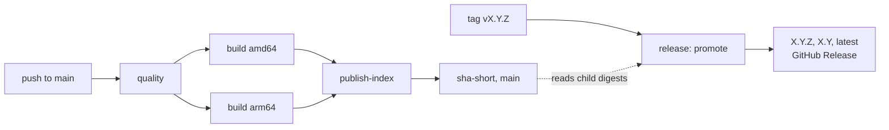

# CI/CD pipeline

How a commit becomes a published multi-architecture image, and how a tag becomes a versioned GitHub Release.

Written to match the workflows as they exist at `2a0688d`. 

**If a workflow changes, this document should change with it.**

---

## 1. The short version

| What you do | What runs | What ends up in GHCR |
|---|---|---|
| Open a pull request | tests, build both architectures, smoke tests | nothing |
| Push to `main` | the same, then publish | `sha-<short>`, `main` |
| Push a `vX.Y.Z` tag | promote the existing `sha-<short>` manifests | `X.Y.Z`, `X.Y`, `latest` + GitHub Release |
<br>
 
 The important property: **a release never builds anything.** 

It re-points tags at the manifests that already passed smoke tests on `main`.



---

## 2. The four workflow files

| File | Trigger | Concurrency | Permissions | Purpose |
|---|---|---|---|---|
| `pr.yml` | `pull_request` | `pr-<number>`, cancels in progress | `contents: read` | validate a PR |
| `publish.yml` | push to `main`, `workflow_dispatch` | `publish-<event>-<ref>`, `queue: max` | `contents: read`, `packages: write` | publish `main` |
| `_pipeline.yml` | `workflow_call` only | none — the caller owns queueing | none at workflow level | shared tests + builds |
| `release.yml` | push of a `v*` tag | `release`, `queue: max` | `contents: write`, `packages: write` | promote + release |
<br>

`_pipeline.yml` never runs on its own. `pr.yml` and `publish.yml` both call it, with `publish: false` and `publish: true` respectively.

Status checks appear under the **caller**, for example `PR / Lint, types, tests` or `Publish / Build and smoke test (arm64)`. 

Nothing is reported under `_pipeline.yml`.

---

## 3. What happens on a pull request

1. `quality` — checkout, uv + Python 3.12, `uv sync --locked`, `ruff format --check`,
   `ruff check`, `mypy`, `pytest`.

2. `build` — matrix of `amd64` on `ubuntu-24.04` and `arm64` on `ubuntu-24.04-arm`,
   running in parallel, `fail-fast: false`.
<br>

Each build job:

- Builds locally with Buildx (`load: true`, `push: false`), tagged `sha-<short>-<arch>`.
- Aliases it to `cert-probe:dev`.
- Runs `make up`, `make smoke`, then the runtime-hardening assertions.
- Skips login, push and digest steps, because `publish` is false.

There is no publishing job in a PR run at all. `publish-index` lives in `publish.yml`.

---

## 4. What happens on a push to `main`

Same `quality` and `build` jobs, with `publish: true`, so each build job additionally:

- Logs in to GHCR.
- Pushes its single-architecture manifest as `sha-<short>-<arch>`.
- Captures the registry manifest digest (see §7) and uploads it as the artifact
  `digest-amd64` / `digest-arm64`, retained one day.

Then `publish-index` in `publish.yml`:

- Downloads both digest artifacts.
- Validates them and confirms both manifests resolve.
- Creates one index from those two child digests, tagged `sha-<short>` and `main`.

`main` is only written when the event is a push to the default branch; a manual dispatch produces `sha-<short>` alone. **`latest` is deliberately not touched here.**

---

## 5. What happens on a tag push

`release.yml` runs one job with nine steps:

| Step | What it does |
|---|---|
| Check out repository | `fetch-depth: 0` so the annotated tag and its commit are present |
| Resolve commit and validate version | `git rev-parse "${GITHUB_REF}^{commit}"`; asserts tag = `v` + `pyproject` version = `APP_VERSION`; rejects anything that is not `X.Y.Z` |
| Log in to GHCR | needed to read and write tags |
| Inspect published index and existing release tag | reads `sha-<short>`, extracts both child digests, and classifies `X.Y.Z` as `absent`, `identical` or conflicting |
| Compute alias eligibility | decides which moving aliases may be written (§8) |
| Create release tags | one `imagetools create` from the two child digests |
| Verify release tags | children, platforms, and digest equality |
| Create GitHub Release | `gh release create --generate-notes`, idempotent |
| Write job summary | tags written, digests, and why any alias was skipped |

If the exact `X.Y.Z` tag already exists with identical content the step is skipped rather than rewritten; if it exists with *different* content the run fails.

---

## 6. Image tags

| Tag | Written by | Moves | Meaning |
|---|---|---|---|
| `sha-<short>-amd64`, `-arm64` | publish | no | one platform manifest each; these are the children |
| `sha-<short>` | publish | no | index for that commit |
| `main` | publish | yes, every main push | newest `main` build |
| `X.Y.Z` | release | **no** — write-once | exact release |
| `X.Y` | release | yes | newest release within that minor |
| `X` | release | yes | newest within that major; only created when major ≥ 1, so no `0` tag |
| `latest` | release | yes | newest release overall |

`latest` tracks releases, not `main`. 

A normal push therefore moves `sha-<short>` and `main` while leaving `latest` where it is.

---

## 7. How promotion works, and why nothing is rebuilt

```
sha-<short>            index
├── linux/amd64  sha256:aaa…   ← immutable manifest, already smoke-tested
└── linux/arm64  sha256:bbb…

release reads those two digests and runs:
docker buildx imagetools create -t …:X.Y.Z -t …:X.Y -t …:latest \
    ghcr.io/owner/repo@sha256:aaa… ghcr.io/owner/repo@sha256:bbb…
```

The result is a **new index object pointing at the same two manifests**. 

Layers and configs are untouched, so the child digests are identical to the tested ones. 

Only the index wrapper is new, in practice it hashes identically when the inputs are identical, but that is not relied upon: verification compares child digests, never the wrapper.

---

## 8. Guard rails

**Digest handling in the build job** — four gates, all fatal:

1. exactly one `RepoDigests` entry for this repository (filters out other repos);

2. it matches `^sha256:[0-9a-f]{64}$` — a manifest digest, not an image ID or config digest;

3. the registry agrees when queried back;

4. only then is it written to `digest-<arch>.txt`.
<br>

**Digest handling in the publish job**

a fifth gate on receipt: exactly two files, one line each, valid digest format, and **amd64 ≠ arm64** (two builds cannot be the same manifest). 

Nothing is stitched until all five pass.
<br>

**Retries** are bounded and only applied where propagation is plausible:

| Where | Attempts | Interval |
|---|---|---|
| build: registry digest agreement | 6 | 5 s |
| publish: digests resolve | 6 | 5 s |
| publish: index readable | 6 | 5 s |
| publish: `main` digest matches | 6 | 5 s |
| release: source index (`404` only) | 3 | 5 s |
| release: release tags readable | 3 | 5 s |
<br>

**404 versus error.** 

Every "does this exist?" check distinguishes a confirmed absence from an authentication, rate-limit or network failure. 

Only a genuine 404 is treated as "absent" or retried; anything else fails the run. An empty version history would make every alias eligible, which is precisely the failure this prevents.
<br>

**Alias monotonicity.** 

`release.yml` reads all published tags, keeps only `vX.Y.Z`, and writes an alias only if the candidate is the maximum for that alias:

- `latest` — maximum of all versions
- `X.Y` — maximum within that minor
- `X` — maximum within that major

So a late `v0.1.5` after `v0.2.0` still gets its exact tag and its Release, and can move `0.1`, but cannot move `latest` backwards. 

Version history comes from **Git tags**, not GitHub Releases, because a tag exists even if `gh release create` failed.

---

## 9. Permissions model

The caller grants; a called workflow can only narrow. 

Declaring *any* permission in a `permissions:` block resets every unlisted scope to `none`, which is why the build job has no such block at all.

| Job | Declared | Effective on a PR | Effective on publish |
|---|---|---|---|
| `quality` | `contents: read` | read | read |
| `build` | *(none — inherits)* | `contents: read` | `contents: read`, `packages: write` |
| `publish-index` | `contents: read`, `packages: write` | not present | read + write |
| `release` | `contents: write`, `packages: write` | not present | read + write |

Adding `permissions: contents: read` to `build` would silently set `packages: none` and break `docker push` on the publish path — the comment in the file says so.

Fork and Dependabot PRs get a read-only token regardless of what the workflow declares.

---

## 10. Concurrency

| Workflow | Group | Behaviour |
|---|---|---|
| `pr.yml` | `pr-<number>` | `cancel-in-progress: true` — a new push to the same PR cancels the old run |
| `publish.yml` | `publish-<event>-<ref>` | `queue: max` — FIFO, up to 100 pending, nothing cancelled |
| `release.yml` | `release` | `queue: max`, single global group |
<br>

`queue: max` and `cancel-in-progress: true` cannot be combined — that is a workflow validation error, which is why PRs and publishing are separate entry workflows.

Two consequences worth remembering:

- Main runs are serialised, so `main` cannot be overtaken by an older commit.

- Releases are serialised globally, so two versions can never interleave on `latest`.
	Beyond 100 pending runs, extra runs are cancelled.

---

## 11. Cutting a release

```bash
# 1. bump the version in both places
#    pyproject.toml        version = "0.2.0"
#    app/main.py           APP_VERSION = "0.2.0"
uv lock                       # if dependencies changed
make check                    # must be green

# 2. commit and push
git add pyproject.toml app/main.py uv.lock
git commit -m "release: prepare v0.2.0"
git push

# 3. WAIT for the Publish run to finish (it creates sha-<short>)

# 4. annotated tag, then push it
git tag -a v0.2.0 -m "v0.2.0"
git push origin v0.2.0
```

Step 3 is not optional. 

The release promotes an index that must already exist; tagging  earlier fails with `no published index for commit <short>`.
<br>

Verify afterwards:

```bash
docker buildx imagetools inspect ghcr.io/OWNER/cert-probe:0.2.0
docker buildx imagetools inspect ghcr.io/OWNER/cert-probe:latest --format '{{.Manifest.Digest}}'
gh release view v0.2.0
```

`X.Y.Z`, `X.Y` and `latest` must report one index digest, listing `linux/amd64` and
`linux/arm64` with the same child digests as `sha-<short>`.

---

## 12. Troubleshooting

| Message | Cause | Fix |
|---|---|---|
| `no published index for commit <short>` | tag placed before Publish finished, or on a commit that never reached `main` | wait for Publish, or tag the right commit |
| `startup_failure` / `requesting 'packages: write', but is only allowed 'packages: none'` | a called job requests more than the caller grants | fix the caller's job permissions; this fails before any job starts |
| `<tag> already exists with different content` | the exact version tag is write-once and content differs | do not reuse a version; cut a new one |
| `does not map the expected manifests to the expected platforms` | index children do not match the tested digests | investigate the publish run for that commit |
| `Artifact not found for name: digest-amd64` | digest artifact missing (build skipped the push, or retention expired) | rerun the publish workflow |
| `queue: max` rejected at validation | combined with `cancel-in-progress: true` | keep them in separate workflows |
| actionlint: `unexpected key "queue"` | the linter's schema predates the `queue` property | run with `-ignore 'unexpected key "queue"'`; do not delete the key |

---

## 13. Known limitations

- **Prereleases are not supported.** Only `X.Y.Z`; `v1.0.0-rc.1` is rejected.

- **No signing or provenance.** `provenance: false` throughout, no SBOM, no cosign.

- **Release notes reflect merged PRs only.** Work pushed straight to `main` appears in the "Full Changelog" link but not in "What's Changed".

- **A tag on an unmerged branch still counts** towards alias maxima.

- **Per-architecture tags accumulate.** Every main push leaves `sha-…-amd64` and `sha-…-arm64`; there is no retention policy yet.

- **`queue: max` caps at 100 pending runs.**

- **actionlint lags behind** on `queue` (latest release v1.7.12, March 2026).

---

## 14. Where to look

| Concern | File |
|---|---|
| tests, builds, smoke, hardening, digest capture | `.github/workflows/_pipeline.yml` |
| PR triggers and cancellation | `.github/workflows/pr.yml` |
| index stitching, `main` tag, publish concurrency | `.github/workflows/publish.yml` |
| version validation, alias rules, release creation | `.github/workflows/release.yml` |
| action pin updates | `.github/dependabot.yml` |

Actions are pinned by commit SHA with the version in a comment. 

Dependabot updates them in grouped PRs; each bumped PR runs the PR workflow before merge.
